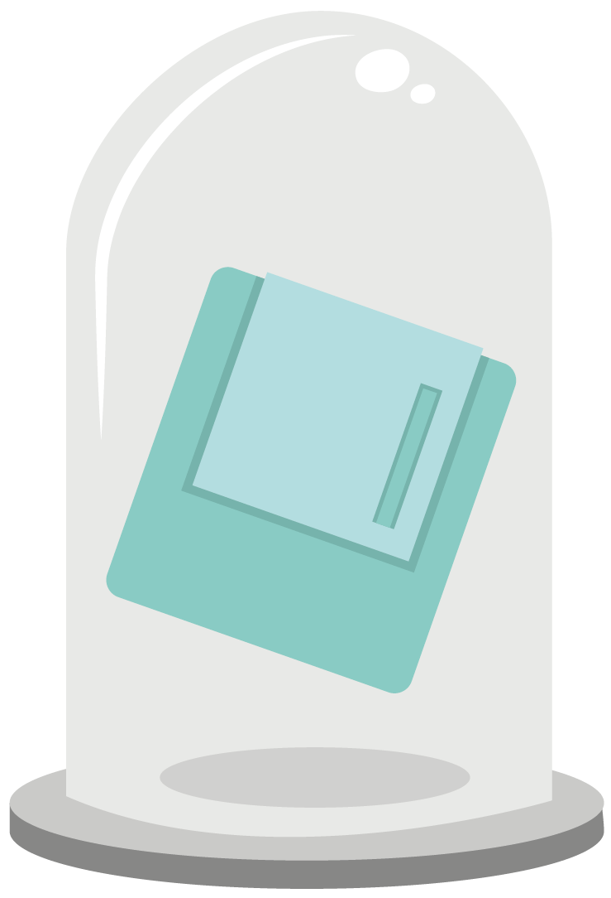
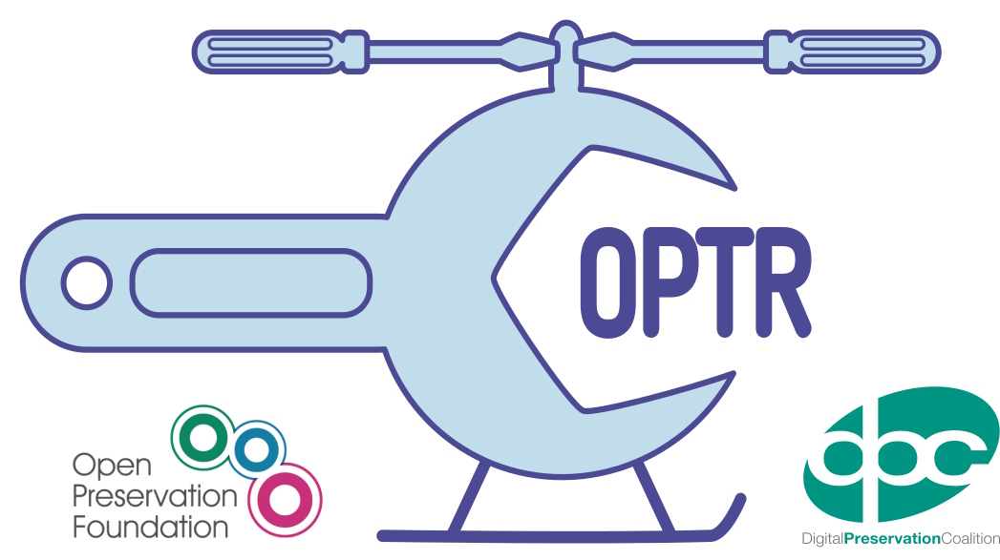
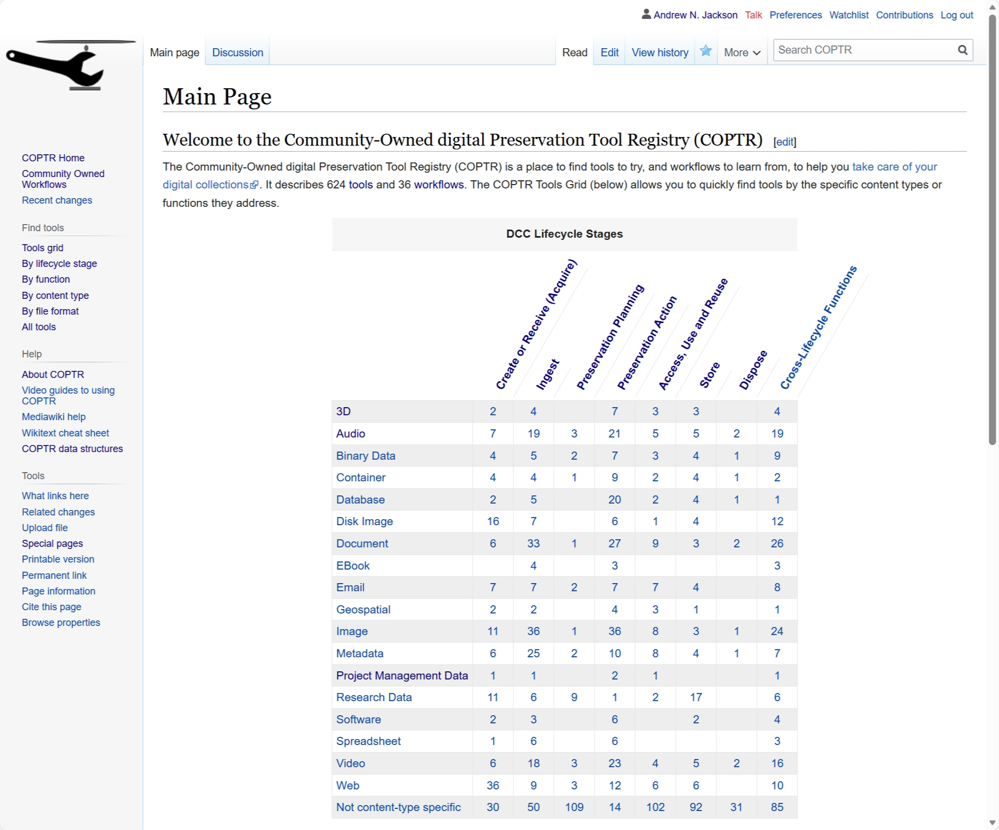

This is a HTML version of the slides I am presenting as part of the "Digital Preservation Tools for Data-Driven Futures" workshop at University College Dublin on 2026-03-13. See [here](https://www.linkedin.com/feed/update/urn:li:activity:7434182210498289664/) for more details.

## Tools, Practices & People

Helping you preserve your digital stuff

## INTRODUCTION

Supporting Digital Preservation

## The Digital Preservation Coalition

…a global community, working together to bring about a sustainable future for our digital assets...


## What is Digital Preservation?

> “the  series   of   managed activities  necessary to ensure  continued access  to digital materials for  as long as necessary…  beyond the limits of media degradation, technical obsolescence or organisational change…’
>
> (Digital Preservation Handbook)
> 
> https://www.dpconline.org/handbook



## DPC Resources

- The Digital Preservation Handbook
  - https://www.dpconline.org/handbook  
- Novice 2 Know How Online Courses
  - https://www.dpconline.org/digipres/prof-development/n2kh-online-training
- Rapid Assessment Model (RAM)
  - https://www.dpconline.org/digipres/implement-digipres/dpc-ram  
- The Global 'Bit List' of Endangered Digital Materials
  - https://bit-list.dpconline.org/  
- Various publications, technology watch, toolkits…
- Also co-host community resources on https://DigiPres.org  

## Organizations

- Digital Preservation Coalition
  - https://www.dpconline.org/  
  - Support for community, advocacy, training, establishing good practice
- Open Preservation Foundation
  - https://openpreservation.org/  
  - Support open source tools and practices specific to digital preservation
- International Internet Preservation Consortium
  - https://netpreserve.org/
  - Support research, practices and tools specific to web archiving

## COPTR (OPF + DPC)



## What is COPTR?

The Community-Owned digital Preservation Tool Registry (COPTR) is a place to find tools to try, and workflows to learn from,  to help you take care of your digital collections.  

https://coptr.digipres.org/About_COPTR  

## Purpose

To help you find tools to try and workflows to learn from!

**Not** to tell you what tools to use.  The right tool often depends on your specific context and goals.

(But by linking tools to user experiences, workflows and other records of practice,  we hope it will be easier to find out what others are doing,  and that this will help you evaluate what you need.)

## FINDING TOOLS

Exploring COPTR by Lifecycle Stage, Function & Content Type

## Live Demonstration



https://coptr.digipres.org/

## FINDING FORMATS

What on Earth are we dealing with?

## Format Identification Is Hard

- Start with DROID (GUI)
  - Or Fido or Siegfried (CLI)
  - All powered by PRONOM from the National Archives (UK)
    - https://www.nationalarchives.gov.uk/pronom/  
- Look up file extensions:
  - Format Aggregator
    - https://www.digipres.org/formats/  
  - Format Index (prototype)
    - https://www.digipres.org/workbench/formats/format-index  

## FINDING INSPIRATION

Learning from the past, and from each other.

## Workflows

COPTR includes…

Community Owned Workflows

https://coptr.digipres.org/Workflow:Community_Owned_Workflows  

DPC Workflow Webinars and COPTR Workflows and other sources are available at:

https://www.digipres.org/workflows/  

## Publications

- Digital Preservation Publications Index
  - Including…
    - Conference Proceedings
    - Blogs
    - Journal Articles
  - Older iPRES-only version:
    - https://www.digipres.org/publications/  
  - Newer version:
    - https://www.digipres.org/publications/awesome-index/


## Each Other & Beyond…

- Talk to each other!
- Ask me things!
- Reach out to other people…
  - Digital preservation appears in many different places
  - Different contexts, different communities
  - See  https://www.digipres.org/communities/ for starting points
- More people & resources to be found via…
  - https://github.com/digipres/awesome-digital-preservation  

## QUESTIONS?

Want to stay in touch?  See  https://www.dpconline.org/digipres/pr-sig   &  https://github.com/orgs/digipres/discussions   & consider joining our online  Collaboration Café  calls!  (Lurkers welcome!)

---

## {coda}

This document was created from the original source using this command:

```sh
pandoc source.pptx -o index.md --extract-media=.
```

And then polished off by hand.